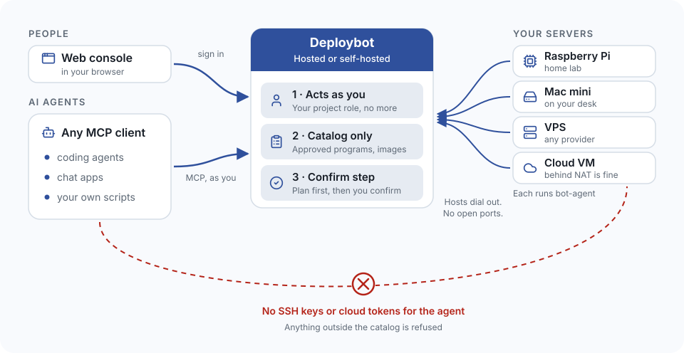

# Deploybot

Let any AI agent that speaks MCP run your own servers, without handing it SSH keys or a cloud token. It can only deploy what your catalog allows, as you, after a confirm step. People use the same controls through a web console.

Deploybot is a control plane for your own hosts: Raspberry Pis, mini PCs, VPSs and cloud VMs. A small agent on each host dials out to the Deploybot API, so hosts open no inbound ports and can sit behind NAT. Use the hosted service at [deploybot.dev](https://deploybot.dev), or run it yourself from this source.

<p align="center">
  
</p>

## How it keeps AI agents safe

- **Acts as you.** An MCP client signs in as you and gets your role in each project, no more.
- **Catalog only.** Only entries your project approved can run: container images and programs. There are no free-form commands, no shell and no file tools.
- **Confirm step.** Every change made over MCP first returns a plan. Nothing happens until it is confirmed.
- **Hosts dial out.** No open ports, and no SSH keys or cloud tokens for the agent.
- **Each host's own allowlist** of images and projects, root-owned on the host, which the server cannot change.
- **Secrets** are encrypted at rest and write-only for people. Changes are recorded in an audit log.

## Three ways to let AI run your servers

| | AI in a terminal (SSH) | AI with your cloud tokens | Deploybot |
|---|---|---|---|
| What the AI can do | Any shell command | Anything the token allows | Only your catalog |
| Safeguard | Approving each command | Hoping the agent behaves | Limited by design: acts as you, confirm step |
| Ports and keys | SSH open, keys on a laptop | Long-lived token in a file | Hosts dial out, no keys for the AI |
| When nobody is watching | Nothing runs | Nothing runs | Health checks, automatic rollback |
| Best for | Debugging one box | Throwaway projects | Running production, teams |

## What else it does

- **Resilience:** deploys wait for health (Docker health status or HTTP/TCP checks); an unhealthy deploy rolls back to the previous container automatically; one-step rollback to an earlier image digest; a health failure policy per service; programs run as systemd units and survive reboot.
- **Visibility:** host metrics with history, running processes and discovered services, health check history per service, container logs with secrets redacted and capped at 10 MB × 3 by default.
- **Teams:** owner, admin and viewer roles per project, invite links that expire, per-entry rights to run, stop, restart or deploy, a host shared with other projects at metrics or deploy level, and one-time join tokens for adding hosts.

## Get started

1. **Sign in** to the console at [console.deploybot.dev](https://console.deploybot.dev) with Google and create a project.
2. **Add a host.** Create a join token in the console (Hosts → Add a host), then follow the [install guide](https://github.com/more-than-code/bot-agent/blob/dev/docs/install.md). Hosts are Linux on amd64 or arm64 with systemd; Docker is needed only for container images. An AI coding agent can do the install for you, except for typing the join token.
3. **Add a catalog entry** for the program or container you want to run, then deploy it from the console.
4. **Connect your AI agent** to `https://mcp.deploybot.dev/mcp`. For example, with Claude Code:

   ```bash
   claude mcp add --transport http deploybot https://mcp.deploybot.dev/mcp
   ```

   Any MCP client with Streamable HTTP and OAuth connects the same way. See the [bot-mcp-server README](https://github.com/more-than-code/bot-mcp-server/blob/dev/README.md) for the tools and for `deploybot login` on machines without a browser.

AI agents can read [deploybot.dev/llms.txt](https://deploybot.dev/llms.txt) for a summary written for them.

## Components

| Component | What it does | Built with | Licence |
|---|---|---|---|
| [bot-agent](https://github.com/more-than-code/bot-agent) | Runs on each host, dials out, deploys catalog entries and reports metrics and health | Go, one static binary; Linux amd64/arm64, systemd | Apache-2.0 |
| [bot-api-server](https://github.com/more-than-code/bot-api-server) | Users, projects, roles, catalog, deploys, audit; the only part that writes the database | Go, PostgreSQL with TimescaleDB | AGPL-3.0-only |
| [bot-mcp-server](https://github.com/more-than-code/bot-mcp-server) | Stateless MCP endpoint for AI agents, acting as the signed-in user | Go, MCP over Streamable HTTP | AGPL-3.0-only |
| [bot-console](https://github.com/more-than-code/bot-console) | The web console | SvelteKit | AGPL-3.0-only |

Development happens on the `dev` branch of each repo.

## Self-hosting

You need a Linux server, PostgreSQL with TimescaleDB, a Google OAuth client, and a reverse proxy for TLS. Each component's README describes how to build, configure and run it, starting with [bot-api-server](https://github.com/more-than-code/bot-api-server/blob/dev/README.md).

The contracts between the parts are public too: the [API](https://github.com/more-than-code/bot-api-server/blob/dev/docs/contracts/api-v1.md), [OAuth](https://github.com/more-than-code/bot-api-server/blob/dev/docs/contracts/oauth-v1.md) and [agent protocol](https://github.com/more-than-code/bot-agent/blob/dev/docs/contracts/agent-protocol-v1.md) contracts.

## Issues and questions

Open an issue in the repo of the component it concerns. If you are not sure which one, open it here.

## License

This repository is under the Apache License 2.0. See [LICENSE](LICENSE). Each component has its own licence, listed in the table above.
